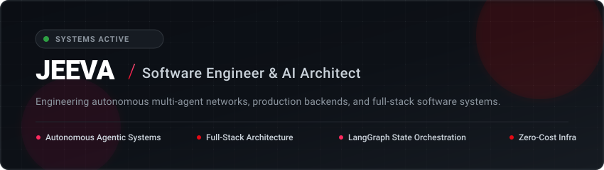
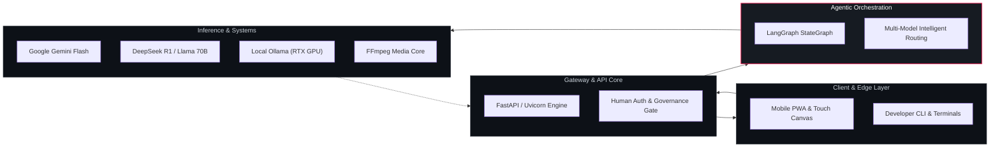

 

---

### ⚡ Executive Summary

I am a software engineer and AI systems builder focused on **computer science fundamentals**, **autonomous agentic workflows**, and **robust full-stack applications**. My work bridges the gap between state-of-the-art Large Language Models and production engineering—designing deterministic StateGraph orchestrations, resilient FastAPI backends, and responsive Progressive Web Apps with human-in-the-loop governance.

Currently engineering zero-cost, private multi-agent operational ecosystems capable of complex real-time routing, automated media pipelines, and dynamic code generation.

---

### 🔬 Core Competencies & Architecture

---

### 🛠️ Technical Stack

<table>
  <tr>
    <td width="25%" valign="top"><strong>Programming Languages</strong></td>
    <td>
      
      
      
      
      
    </td>
  </tr>
  <tr>
    <td valign="top"><strong>AI &amp; Agentic Systems</strong></td>
    <td>
      
      
      
      
      
      
    </td>
  </tr>
  <tr>
    <td valign="top"><strong>Backend Engineering</strong></td>
    <td>
      
      
      
      
      
    </td>
  </tr>
  <tr>
    <td valign="top"><strong>Frontend &amp; Creative</strong></td>
    <td>
      
      
      
      
      
    </td>
  </tr>
  <tr>
    <td valign="top"><strong>Media &amp; Systems Tools</strong></td>
    <td>
      
      
      
    </td>
  </tr>
  <tr>
    <td valign="top"><strong>DevOps &amp; Infrastructure</strong></td>
    <td>
      
      
      
      
    </td>
  </tr>
</table>

---

### 🚀 Featured Engineering Projects

<table>
  <thead>
    <tr>
      <th width="35%">Repository &amp; Overview</th>
      <th width="45%">Architecture &amp; Features</th>
      <th width="20%">Stack</th>
    </tr>
  </thead>
  <tbody>
    <tr>
      <td>
        <a href="https://github.com/jeeva4th/ai-organization"><strong>🏛️ Personal AI Organization</strong></a>
         
        Autonomous, Hierarchical Multi-Agent AI Organization with LangGraph Orchestrator &amp; Private Mobile Hub
      </td>
      <td>
        • <strong>LangGraph Orchestration:</strong> StateGraph routing across autonomous specialized departments (Video, Web, QA, Debugger). 
        • <strong>Private Mobile PWA:</strong> 100% private command interface with voice dictation &amp; real-time execution stream. 
        • <strong>Pro Studio Core:</strong> Multi-layer canvas editor and FFmpeg video pipeline (aspect ratio conversion, RMS loudness scene detection). 
        • <strong>Human Governance:</strong> 1-tap founder authorization gate for all deployments and external actions. 
        • <strong>Verified Quality:</strong> 69/69 automated Pytest test suites passing.
      </td>
      <td>
        <code>Python 3.14</code> 
        <code>LangGraph</code> 
        <code>FastAPI</code> 
        <code>React / PWA</code> 
        <code>FFmpeg</code> 
        <code>Docker</code>
      </td>
    </tr>
    <tr>
      <td>
        <a href="https://github.com/jeeva4th/theia"><strong>☁️ Eclipse Theia Exploration</strong></a>
         
        Cloud &amp; Desktop IDE Framework Architecture
      </td>
      <td>
        • Deep dive into extensible, modular IDE frameworks built in TypeScript. 
        • Analysis of language server protocol (LSP), widget containers, and workspace virtualization.
      </td>
      <td>
        <code>TypeScript</code> 
        <code>Electron</code> 
        <code>LSP</code> 
        <code>Node.js</code>
      </td>
    </tr>
    <tr>
      <td>
        <a href="https://github.com/jeeva4th/Project-V1"><strong>⚡ Project-V1</strong></a>
         
        Creator Systems &amp; Modular Workflow Architecture
      </td>
      <td>
        • Core foundation and architectural scaffolding for specialized creator tools and prototype workflows.
      </td>
      <td>
        <code>Systems Design</code> 
        <code>Automation</code>
      </td>
    </tr>
    <tr>
      <td>
        <a href="https://github.com/jeeva4th/Notes"><strong>📚 Computer Science &amp; Git Architecture</strong></a>
         
        Engineering Knowledge Repository
      </td>
      <td>
        • Version control methodologies, Git workflows, branching strategies, and foundational computer science practices.
      </td>
      <td>
        <code>Git</code> 
        <code>Documentation</code>
      </td>
    </tr>
  </tbody>
</table>

---

### 📊 Engineering Statistics & Metrics

  <table border="0">
    <tr>
      <td>
        
      </td>
      <td>
        
      </td>
    </tr>
  </table>

   

  

---

### 🌐 Connect & Collaborate

 

Built with an obsession for clean architectures, autonomous intelligence, and high-performance software engineering.

